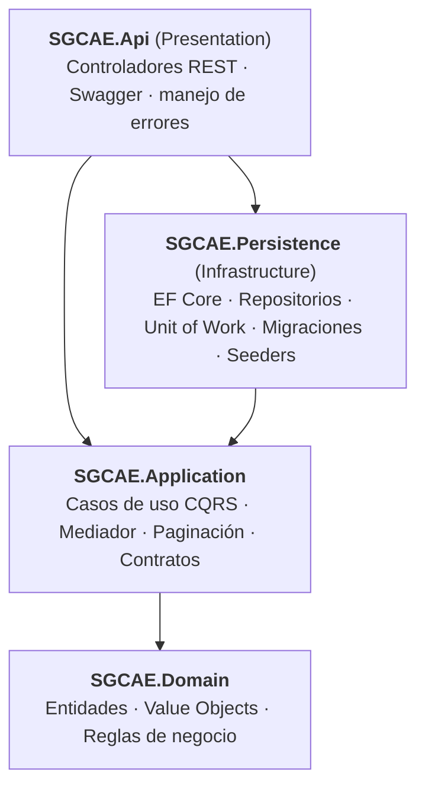

# SGCAE — Sistema de Gestión y Control de Acceso de Empleados

Backend empresarial para gestionar y controlar los accesos de los empleados a las instalaciones de una organización. Trabajo de la materia **Programación Distribuida** (Seguimiento 2).

Es una API REST en **ASP.NET Core** (.NET 10) con persistencia en **SQL Server** mediante **Entity Framework Core**, construida con **Clean Architecture**, **Domain-Driven Design (DDD)** y **CQRS**.

## ¿Qué hace?

- **Empleados** (RF-01): registrar, consultar, actualizar y desactivar.
- **Credenciales** (RF-02): asignar, consultar su estado, bloquear y revocar.
- **Registro de accesos** (RF-03): recibe el código de una credencial, el punto de acceso y el tipo de movimiento (entrada o salida), valida las condiciones y guarda el resultado. **Los accesos rechazados también se registran**, con su motivo.
- **Historial de accesos** (RF-04): consulta por empleado, rango de fechas, punto de acceso y resultado, con paginación.
- **Puntos de acceso** (RF-06): registrar, consultar y habilitar o deshabilitar.

## Arquitectura

La solución tiene cuatro proyectos (capas). Las dependencias apuntan siempre hacia adentro: el dominio es el núcleo y no depende de ninguna otra capa.



La capa Api referencia a Persistence solo para registrar las dependencias al arrancar; los controladores trabajan únicamente con el mediador y los casos de uso. Application define las interfaces de los repositorios y Persistence las implementa, por eso Application no depende de SQL Server.

| Capa | Proyecto | Responsabilidad |
|---|---|---|
| Domain | `SGCAE.Domain` | Entidades, value objects, enumeraciones y excepción de negocio. |
| Application | `SGCAE.Application` | Comandos y consultas (CQRS) con sus casos de uso, mediador propio, paginación y contratos de repositorio y Unit of Work. |
| Infrastructure | `SGCAE.Persistence` | `SGCAEDbContext`, configuraciones de EF Core, repositorios, Unit of Work, migraciones y datos de ejemplo. |
| Presentation | `SGCAE.Api` | Controladores, Swagger y manejo de errores. |

### Patrones aplicados

- **CQRS**: los comandos modifican datos y las consultas solo leen; cada uno tiene su propia clase y su propio caso de uso.
- **Mediator**: `IMediator` / `SimpleMediator` desacopla los controladores de los casos de uso.
- **Repository** y **Unit of Work**: el repositorio prepara los cambios y el Unit of Work los confirma.
- **DDD**: las entidades validan sus propias reglas y lanzan `BusinessRuleException`.

## Modelo de dominio

| Elemento | Tipo | Descripción |
|---|---|---|
| `Empleado` | Entidad | Identificación, nombres, apellidos, correo, cargo, área y estado laboral (`Activo` / `Inactivo`). |
| `Credencial` | Entidad | Código único, empleado, estado (`Vigente` / `Bloqueada` / `Revocada`) y fecha de asignación. |
| `PuntoAcceso` | Entidad | Nombre único, descripción opcional y si está habilitado. |
| `RegistroAcceso` | Entidad | Historial: código leído, empleado, punto, tipo, resultado, motivo de rechazo y fecha. No se modifica nunca. |
| `Identificacion`, `CorreoElectronico`, `CodigoCredencial` | Value objects | Se validan solos al crearse. |

### Validación de un acceso (RF-03)

Las condiciones se evalúan en este orden; la primera que falla es el motivo del rechazo:

| # | Condición | Motivo si falla |
|---|---|---|
| 1 | La credencial existe | `CredencialNoEncontrada` |
| 2 | La credencial está vigente (no bloqueada ni revocada) | `CredencialNoVigente` |
| 3 | El empleado está activo | `EmpleadoInactivo` |
| 4 | El punto de acceso está habilitado | `PuntoAccesoDeshabilitado` |
| 5 | No entra quien ya está adentro | `YaSeEncuentraAdentro` |
| 6 | No sale quien no ha entrado | `NoHaIngresado` |

Un acceso rechazado **no es un error**: se guarda con su motivo y la API responde `200`. Los datos mal formados (código inválido, tipo de movimiento inválido) responden `400`, y un punto de acceso inexistente responde `404`; en esos casos no se registra nada.

## Requisitos

- .NET SDK 10
- SQL Server (LocalDB, Express o Developer)

## Cómo ejecutar el proyecto

Todos los comandos se ejecutan desde la raíz del repositorio.

1. Clonar el repositorio:

   ```
   git clone https://github.com/marianasuazas/Seguimiento2.git
   cd Seguimiento2
   ```

2. Revisar la cadena de conexión en `SGCAE.Api/appsettings.json`, clave `ConnectionStrings:SGCAEDb`. Por defecto apunta a `(localdb)\MSSQLLocalDB` con autenticación de Windows; hay que ajustarla si se usa otra instancia de SQL Server.

3. Ejecutar la API:

   ```
   dotnet run --project SGCAE.Api --launch-profile http
   ```

4. Abrir Swagger en <http://localhost:5080/swagger> para probar los endpoints.

En el entorno de desarrollo, **al arrancar la API se crea la base de datos `SGCAEDb` (se aplican las migraciones) y se cargan datos de ejemplo** si las tablas están vacías. No hace falta ejecutar ningún comando de Entity Framework.

### Datos de ejemplo

| Empleado | Identificación | Credencial | Situación |
|---|---|---|---|
| Laura Gómez Rojas | 1001 | `LAURA-001` | Normal |
| Carlos Pérez Ruiz | 1002 | `CARLOS-001` | Normal |
| Diana Martínez León | 1003 | `DIANA-001` | Normal |
| Andrés Torres Vega | 1004 | `ANDRES-001` | **Credencial bloqueada** |
| Marcela Ríos Soto | 1005 | `MARCELA-001` | **Empleada inactiva** |

Puntos de acceso: `Recepción principal`, `Parqueadero`, `Bodega de carga` y `Área restringida de servidores` (**deshabilitado**).

## Endpoints

Ruta base: `http://localhost:5080`. La documentación interactiva está en `/swagger`.

| Método | Ruta | Descripción | Respuestas |
|---|---|---|---|
| POST | `/api/empleados` | Registra un empleado | 201, 400 |
| GET | `/api/empleados` | Lista los empleados (paginada) | 200 |
| GET | `/api/empleados/{id}` | Consulta un empleado | 200, 404 |
| PUT | `/api/empleados/{id}` | Actualiza un empleado | 204, 400, 404 |
| PATCH | `/api/empleados/{id}/desactivar` | Desactiva un empleado | 204, 400, 404 |
| POST | `/api/credenciales` | Asigna una credencial a un empleado | 201, 400, 404 |
| GET | `/api/credenciales/{id}` | Consulta una credencial y su estado | 200, 404 |
| GET | `/api/empleados/{empleadoId}/credenciales` | Credenciales de un empleado | 200 |
| PATCH | `/api/credenciales/{id}/bloquear` | Bloquea una credencial | 204, 400, 404 |
| PATCH | `/api/credenciales/{id}/revocar` | Revoca una credencial | 204, 400, 404 |
| POST | `/api/puntos-acceso` | Registra un punto de acceso | 201, 400 |
| GET | `/api/puntos-acceso` | Lista los puntos de acceso (paginada) | 200 |
| GET | `/api/puntos-acceso/{id}` | Consulta un punto de acceso | 200, 404 |
| PATCH | `/api/puntos-acceso/{id}/estado` | Habilita o deshabilita un punto | 204, 400, 404 |
| POST | `/api/accesos` | Registra una entrada o salida | 200, 400, 404 |
| GET | `/api/accesos` | Historial con filtros y paginación | 200, 400 |

Las listas aceptan `pageNumber` y `pageSize` (por defecto 1 y 15; máximo 50). El historial acepta además `empleadoId`, `desde`, `hasta`, `puntoAccesoId` y `resultado` (`Autorizado` o `Rechazado`). Las fechas con `Z` se leen como UTC.

### Ejemplos de peticiones

El archivo [`SGCAE.Api/SGCAE.Api.http`](SGCAE.Api/SGCAE.Api.http) trae ejemplos listos para ejecutar (compatible con Visual Studio y con la extensión REST Client de VS Code), y las capturas de las peticiones exitosas y de los errores de validación están en [`docs/Evidencias_API.pdf`](docs/Evidencias_API.pdf).

**Acceso autorizado**

```
POST /api/accesos
{ "codigo": "LAURA-001", "puntoAccesoId": "<id de Recepción principal>", "tipo": "Entrada" }
```

```
200 OK
{ "resultado": "Autorizado", "motivo": null, "tipo": "Entrada", ... }
```

**Acceso rechazado** (la credencial está bloqueada)

```
POST /api/accesos
{ "codigo": "ANDRES-001", "puntoAccesoId": "<id de Recepción principal>", "tipo": "Entrada" }
```

```
200 OK
{ "resultado": "Rechazado", "motivo": "CredencialNoVigente", ... }
```

**Errores de validación de dominio** — responden `400` con el mensaje de la regla incumplida:

| Petición | Respuesta |
|---|---|
| `POST /api/empleados` con un correo sin formato válido | `{ "error": "El correo electrónico no tiene un formato válido." }` |
| `POST /api/empleados` con una identificación repetida | `{ "error": "Ya existe un empleado con esa identificación." }` |
| `POST /api/credenciales` con un código ya usado | `{ "error": "Ya existe una credencial con ese código." }` |
| `PATCH /api/credenciales/{id}/bloquear` sobre una ya bloqueada | `{ "error": "La credencial ya está bloqueada." }` |
| `POST /api/accesos` con un código mal formado | `{ "error": "El código de la credencial solo puede contener letras, números y guiones." }` |
| `GET /api/empleados/{id}` con un id que no existe | `404` con `{ "error": "El empleado no existe." }` |

## Estructura del repositorio

```
SGCAE.slnx
SGCAE.Domain/        Entities, ValueObjects, Enums, Exceptions
SGCAE.Application/   Contracts, UseCases (Empleados, Credenciales, PuntosAcceso, Accesos), Utilities
SGCAE.Persistence/   Configurations, Repositories, Seeds, Migrations
SGCAE.Api/           Controllers, Middleware, Requests
docs/                Evidencias de la API
```

## Flujo de trabajo con Git (Git Flow)

- `main`: versión estable y entregable; se actualiza desde `develop` en cada entrega.
- `develop`: rama de integración; todas las ramas de trabajo salen de ella y los Pull Requests apuntan a ella.
- `feature/*`: una rama por módulo y por capa (`feature/domain-empleados`, `feature/domain-credenciales`, `feature/domain-accesos`, `feature/application-base`, `feature/application-empleados`, `feature/application-credenciales-puntos`, `feature/application-accesos`, `feature/persistence`, `feature/api`), integradas a `develop` mediante Pull Request.

El gráfico de red se puede ver en GitHub, en **Insights → Network**.
